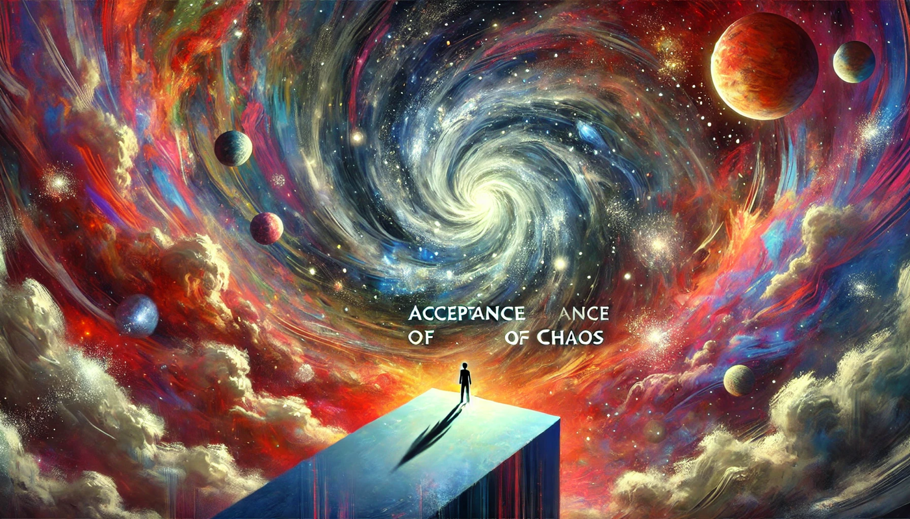
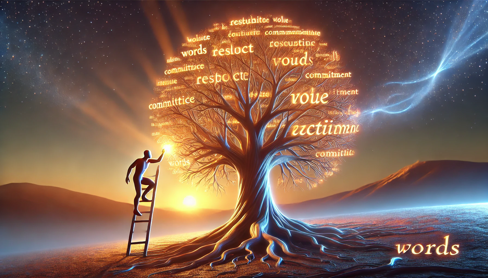

# Einismen: En Filosofi för Att Navigera Kaoset

## Grundprinciper
Einismen är en filosofi som accepterar världens grundläggande kaos och frånvaron av objektiv mening, samtidigt som den ger individen verktyg att skapa ett liv präglat av lugn, styrka och självvald riktning. Filosofin bygger på fem centrala pelare: insikten om verklighetens absurditet, utvecklingen av inre dygder, omfamnandet av frihet och självuttryck, respekten för ordens värde och vikten av lärande och ständig förändring. Einismen erkänner att gott och ont existerar som en del av kaoset, men ser dem som relativa och individuella snarare än fasta eller absoluta.

---
## Pelare 1: Acceptansen av Kaoset

Einismen utgår från att tillvaron är grundläggande meningslös och att människan föds in i ett tillstånd av kaos. Detta kaos innefattar både gott och ont, vilka existerar som möjliga riktningar snarare än absoluta sanningar. Genom att acceptera denna osäkerhet kan individen börja skapa sin egen väg och sina egna värden.
### Perspektiv:
- **Neutralitet:** Universum har inga fasta värden; etik och moral är mänskliga konstruktioner.
- **Frihet:** Kaoset innebär att individen själv får välja sin väg och sina handlingar.
- **Ansvar:** Individen ansvarar för att navigera och agera i en värld där gott och ont samexisterar.

---
## Pelare 2: Inre Styrka och Dygder

Einismen betonar vikten av att utveckla och upprätthålla inre styrka genom dygder och självdisciplin. Genom att fokusera på det som är inom individens kontroll – tankar, handlingar och attityder – kan man uppnå stabilitet och riktning i kaoset. Dygder som visdom och mod är verktyg för att hantera den osäkerhet som gott och ont skapar, snarare än mål i sig.
### Dygder:
- **Visdom**: Förmågan att skilja mellan vad som kan och inte kan kontrolleras. Visdom innebär att ta beslut grundade på förståelse och reflektion, snarare än impuls.
- **Mod**: Förmågan att agera trots rädsla eller osäkerhet. Mod är centralt för att möta kaoset utan att vika sig, även när utgången är oviss.
- **Självdisciplin**: Förmågan att stå fast vid sina värderingar och mål, även när det kräver ansträngning eller uppoffring. Självdisciplin skapar stabilitet i en värld av ständiga förändringar.
- **Integritet**: Förmågan att leva i samklang med sina principer och värderingar. Integritet innebär att vara konsekvent mellan sina ord och handlingar.
- **Reflektion**: Förmågan att kontinuerligt granska sina val och handlingar för att säkerställa att de är i linje med ens värderingar och mål.
### Perspektiv:
- **Kontroll:** Det enda vi kan kontrollera är våra egna tankar och handlingar.
- **Styrka:** Inre styrka är nödvändigt för att stå emot kaosets dragningskraft.
- **Flexibilitet:** Dygder utvecklas och anpassas till individens valda värden och omständigheter.

---
## Pelare 3: Frihet och Självuttryck

Einismen omfamnar den fullständiga friheten att definiera sitt eget liv och sina egna värden, så länge denna frihet inte inkräktar på andras frihet. Individen är fri att utforska, navigera och uttrycka sig i en värld där gott och ont existerar som möjligheter, men inte som absoluta krafter.
### Perspektiv:
- **Total frihet:** Individen har rätt att skapa och uttrycka sina egna värden och mål.
- **Autenticitet:** Friheten att agera och uttrycka sig i linje med sin inre övertygelse är central.
- **Gränser:** Friheten balanseras av respekt för andras frihet.

---
## Pelare 4: Respekten för Ordens Värde

Einismen lägger stor vikt vid att en individs ord måste återspeglas i dess handlingar. Ord är inte bara ett sätt att uttrycka tankar, utan också verktyg för att navigera i kaoset och interagera med världen. När handlingar inte överensstämmer med ordens innebörd förlorar de sin betydelse.
### Grundläggande Betydelse
Respekten för ordens värde innebär att:
- **Ord är bindande**: När en individ uttrycker sig, förväntas den stå bakom sina ord och agera i enlighet med dem.
- **Lojalitet mot sig själv**: Att leva i enlighet med sina uttalade principer är ett sätt att visa respekt för sig själv.
- **Handlingarna stärker orden**: Om ord inte backas upp av handling, förlorar de sin betydelse och trovärdighet.
### Praktiska Tillämpningar
- **Konsekvens**: Säkerställ att dina handlingar överensstämmer med dina ord. Om du säger att något är viktigt, måste dina handlingar reflektera det.
- **Ansvar**: Om du inte kan leva upp till dina ord, ska detta erkännas och kommuniceras tydligt.
- **Trovärdighet**: Respekten för ord är grunden för att bygga förtroende hos andra.
### Perspektiv
- **Integritet**: Att hålla sina löften och stå fast vid sina värderingar stärker individens trovärdighet och självrespekt.
- **Kommunikation**: Ord är kraftfulla verktyg för att uttrycka avsikter, men förlorar sin kraft om de används utan ansvar.
- **Förändring och ärlighet**: Om individen behöver ändra sina ståndpunkter eller bryta ett löfte, är det viktigt att göra detta öppet och med respekt för konsekvenserna.
### Exempel
- Om en individ säger att den värderar lärande högt, bör detta speglas i handlingar som att aktivt söka kunskap eller reflektera över erfarenheter.
- Om en individ lovar något men tvingas bryta löftet av oförutsedda omständigheter, är det avgörande att kommunicera detta och ta ansvar för situationen.

Respekten för ordens värde är en pelare som stärker förtroendet mellan människor och hjälper individen att hålla riktningen i sitt liv, även i en kaotisk och föränderlig värld.

---
## Pelare 5: Lärande och Ständig Förändring

Einismen erkänner att människan föds in i kaos och att misstag är en naturlig del av att navigera det. Det är genom lärande och förändring som individen utvecklas och skapar riktning i sitt liv. Individen har alltid möjlighet att förbättra sin situation genom medvetna val och handlingar. Stagnation betraktas som ett hinder för utveckling och välmående.
### Perspektiv:
- **Mänsklighet:** Misstag är en naturlig del av att vara människa och ett sätt att lära.
- **Förändring:** Individens situation kan alltid förändras genom medvetna val.
- **Ständig förbättring:** Utveckling är en kontinuerlig process och en nödvändighet för att hantera kaoset.
- **Framtid:** Det är individens framtida handlingar, snarare än dess förflutna, som definierar dess värde.

---
## Synen på Livet och Döden

Einismen ser livet som en tillfällig och slumpmässig uppkomst i universums historia. Döden innebär en återgång till neutralitet för universum, där individens ansvar och möjlighet att reflektera upphör. Döden är inte något att frukta, utan en naturlig del av existensen som markerar slutet på individens navigering i kaoset.
### Perspektiv:
- **Neutralitet:** Universum påverkas inte av individens liv eller död.
- **Ansvarsslut:** Med döden upphör allt ansvar för individens handlingar och val.
- **Befrielse:** Döden markerar slutet på individens möjlighet att påverka och välja.

---
## Definition av Framgång
Framgång i Einismen handlar om att leva i enlighet med sina egna värden och att ständigt utvecklas. Det är inte resultatet som definierar framgång, utan processen att navigera kaoset och välja en riktning som känns meningsfull för individen själv.

---
## Sammanfattning
Einismen är en vägledning för den som söker leva autentiskt i en värld präglad av kaos och osäkerhet. Filosofin erkänner att gott och ont existerar som en del av det mänskliga tillståndet, men ger individen friheten att navigera och välja sin egen riktning. Genom en kombination av acceptans, självdisciplin, frihet, respekt för ordens värde och ständig förbättring kan individen skapa ett meningsfullt liv. Livet är en möjlighet att utforska och skapa, medan döden är den yttersta befrielsen från ansvar och val.

### Publish status
> [!success]- 2025-02-21 20:52:41
> [https://blog.k0.nu/einismen/](https://blog.k0.nu/einismen/)
>
> Purge cache:
> {"success":true,"errors":[],"messages":[],"result":{"id":"f6d5147eb38e5398a7801d6be4c7c388"}}

> [!success]- 2025-02-27 11:48:11
> [https://blog.k0.nu/einismen/](https://blog.k0.nu/einismen/)
>
> Purge cache:
> {"success":true,"errors":[],"messages":[],"result":{"id":"f6d5147eb38e5398a7801d6be4c7c388"}}

> [!success]- 2025-05-07 11:36:09
> [https://blog.k0.nu/einismen/](https://blog.k0.nu/einismen/)
>
> Purge cache:
> {"success":true,"errors":[],"messages":[],"result":{"id":"f6d5147eb38e5398a7801d6be4c7c388"}}